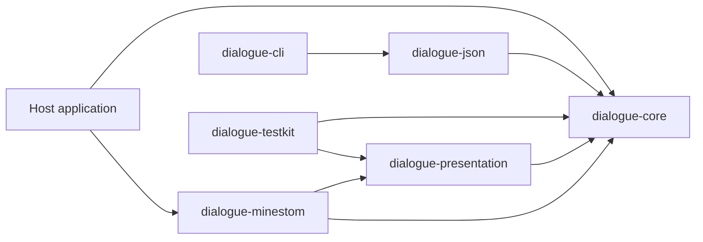

# Dialogue architecture

This maps the current 1.8.0 source. There are six version-aligned artifacts; Kotlin implements the library and Java remains a consumer language. The [README](../README.md) selects modules; the [quickstart](quickstart.md) runs the existing examples.

Core, JSON and Presentation do not depend on Minestom, Scene or NPC. The native adapter borrows an application-supplied runtime; CLI and Testkit add tooling rather than game authority.

## API and ownership map

Paths below are the implementation of today's contracts, not proposed replacement APIs.

| Responsibility               | Entry point                                                                                                                                                                                                                                                                                                         | Ownership                                                                                                    |
| ---------------------------- | ------------------------------------------------------------------------------------------------------------------------------------------------------------------------------------------------------------------------------------------------------------------------------------------------------------------- | ------------------------------------------------------------------------------------------------------------ |
| Definitions and validation   | [DialogueBuilder](../dialogue-core/src/main/kotlin/gg/grounds/dialogue/core/definition/DialogueBuilder.kt), [validation package](../dialogue-core/src/main/kotlin/gg/grounds/dialogue/core/validation)                                                                                                              | Host supplies catalogues; validator produces executable content                                              |
| Local sessions               | [DialogueRuntime](../dialogue-core/src/main/kotlin/gg/grounds/dialogue/core/runtime/DialogueRuntime.kt), [DialogueStart](../dialogue-core/src/main/kotlin/gg/grounds/dialogue/core/runtime/DialogueStart.kt), [DialogueHandle](../dialogue-core/src/main/kotlin/gg/grounds/dialogue/core/runtime/DialogueHandle.kt) | Runtime owns request dedupe and sessions; session owns graph, reveal, selection and freshness                |
| Host clock and callbacks     | [DialogueScheduler](../dialogue-core/src/main/kotlin/gg/grounds/dialogue/core/port/DialogueScheduler.kt), [host ports](../dialogue-core/src/main/kotlin/gg/grounds/dialogue/core/port)                                                                                                                              | Host owns monotonic time, executor and external effects                                                      |
| Renderer and actor lifetimes | [DialogueRenderer](../dialogue-core/src/main/kotlin/gg/grounds/dialogue/core/port/DialogueRenderer.kt), [ActorPort](../dialogue-core/src/main/kotlin/gg/grounds/dialogue/core/port/ActorPort.kt), [OwnedResource](../dialogue-core/src/main/kotlin/gg/grounds/dialogue/core/port/OwnedResource.kt)                  | Prepare hidden output; activate actors once; close only acquired resources                                   |
| Layout and surfaces          | [DialoguePresenter](../dialogue-presentation/src/main/kotlin/gg/grounds/dialogue/presentation/DialoguePresenter.kt), [DialogueSurface](../dialogue-presentation/src/main/kotlin/gg/grounds/dialogue/presentation/DialogueSurface.kt)                                                                                | Presenter owns surface acquisition, replacement acknowledgements and switching; surface owns platform output |
| Native connection host       | [MinestomDialogueHost](../dialogue-minestom/src/main/kotlin/gg/grounds/dialogue/minestom/MinestomDialogueHost.kt), [MinestomDialogueOptions](../dialogue-minestom/src/main/kotlin/gg/grounds/dialogue/minestom/MinestomDialogueOptions.kt)                                                                          | One connection owner coordinates input, borrowed anchors, pack state and output cleanup                      |

## Scheduler and resource rules

The Core creates no threads. The host keeps `DialogueScheduler` alive until cleanup settles and dispatches blocking I/O on its own executor. Port methods return `CompletionStage` promptly. Session state and asynchronous replies are serialized; foreign callbacks run outside internal state monitors. A second helper clock or independent mutable session state must not bypass that owner.

Preparation registers ownership before invoking asynchronous acquisition. Hidden resources activate only after admission. Late results are either accepted by the current generation or closed by their original owner. Stop invalidates immediately, cancels input/effects admission and closes owned resources in reverse acquisition order. Public observer stages do not cancel owned work: use explicit cancellation/stop. Failed or timed-out cleanup cannot be reported as confirmed success.

The native host borrows player, instance, speaker body and Minestom engine. It never migrates those handles across processes or stops that engine. Disconnect, instance change and transfer end the local session. Network-wide identity/presence, durable effect dedupe, permissions and reconciliation stay with host services. See [host contracts](host-contracts.md).

## Presentation and authoring

Builder and JSON inputs converge on the same definitions, validator and content fingerprint. A message has `next` or choices; each choice list needs an unconditional option. Conditions are rechecked before confirm. The library accepts named bytes and does not discover map folders or activate content.

[DialoguePresenter](../dialogue-presentation/src/main/kotlin/gg/grounds/dialogue/presentation/DialoguePresenter.kt) retains the profile registry and owns surface acquisition, serialized writes, replacement acknowledgements, switching and cleanup. Its public `compose` facade delegates to implementation-only [frame composition](../dialogue-presentation/src/main/kotlin/gg/grounds/dialogue/presentation/internal/DialogueFrameComposer.kt): label resolution and routing select generic panel layout or the existing HUD raster layout. Those composers consume view/profile/preferences snapshots and optional choice cursor offsets; they own no scheduler, surface handles or mutable session state. Shared pure helpers keep text fallback, widget geometry, scrollbar rounding and surface profile pins consistent.

Presentation composes a full view into widgets and owned frame writes. Semantic surfaces can render without glyph metrics. Graphical missing-glyph/overflow errors are typed; the Minestom host can retain the session and fall back to chat. Graphical hover rectangles remain fixed while selection visuals grow. The host owns pack composition, hosting and transmission; exact successful registration is required for graphics. See [Minestom integration](minestom-integration.md).

## Implementation boundary and history

The current state machine is in [SessionDriver](../dialogue-core/src/main/kotlin/gg/grounds/dialogue/core/internal/SessionDriver.kt); native orchestration is in [MinestomDialogueSession](../dialogue-minestom/src/main/kotlin/gg/grounds/dialogue/minestom/internal/MinestomDialogueSession.kt). `.internal` is a package policy, not universal JVM access control. Shared implementation helpers are public where modules need them. Some concrete native constructors currently expose an internal connection guard; use `MinestomDialogueHost` for ordinary integration. Do not infer a stable extension contract merely from public bytecode.

The original four APIs and JSON-v1 schemas have a [strict compatibility baseline](../compatibility/baseline.json). [Contributing](../CONTRIBUTING.md) explains verification. [Client acceptance](client-acceptance.md) is a historical evidence record with artifact-specific results and explicit waivers, not the live API guide or a standing request to repeat waived tests.
